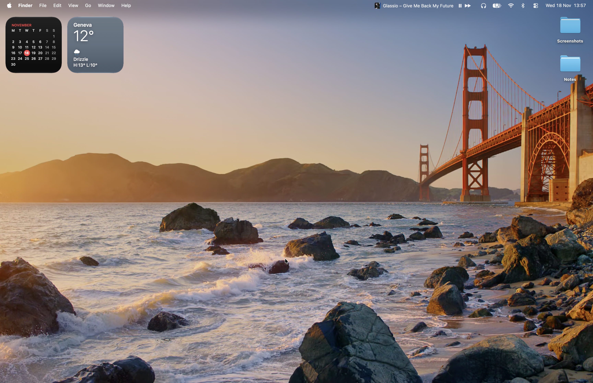

# Now Playing
A simple menu bar app that shows what's playing on your Mac. 

Born out of frustration with the Mac's default "Now Playing" app which hides what's playing behind a click, this menu bar app displays what's playing directly on the menu bar. 

**What it does:** the menu bar item shows the album art, artist and title of what's currently playing on your Mac. This works with any app that plays media to your Mac. 

**How it works:** it polls the MediaRemote system API to see what your Mac is playing every 2 seconds. 

**Build and run:** `./build.sh && open NowPlaying.app`

**Tested:** The app was tested with Spotify. Since it uses the MediaRemote API, it should 

**Files in [`~/repos/now-playing`](~/repos/now-playing):**

- [`main.swift`](main.swift): the menu bar app.
- [`helper.c`](helper.c): a small C library that asks the system for the now-playing info.
- [`build.sh`](build.sh): builds the app bundle and ad-hoc signs it.
- [`.gitignore`](.gitignore): ignores `NowPlaying.app`.

**Why there's a helper:** a direct call to the MediaRemote system API returns `nil` for normal apps on this macOS, so the Swift app can't call it. The app runs [`/usr/bin/perl`](/usr/bin/perl) and loads `helper.dylib` into it. Apple signs Perl, so the call goes through. 

**Cost of polling:** each poll starts a new perl process. That's fine at a 2 second interval, but it isn't free.